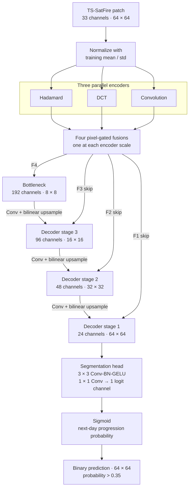

# WildfireTD4 — next-day wildfire progression



Each encoder produces four feature maps: **24 × 64 × 64**, **48 × 32 × 32**,
**96 × 16 × 16**, and **192 × 8 × 8** (channels × height × width). Each gate
projects the three branch features with 1 × 1 convolutions and uses a pixel-wise
softmax to form their weighted sum. Decoder stages concatenate the corresponding
fused skip with the upsampled feature, then apply a Conv-BN-GELU block.

**Training:** logits → focal Tversky recall loss against the progression target,
with alpha **0.4**, beta **0.6**, gamma **1.33**. **Inference:** sigmoid → threshold;
**0.35** is the selected checkpoint's threshold. **5,973,133 parameters**.

The primary model is **WildfireTD4**: a custom four-scale U-Net with parallel
Hadamard, DCT and convolution encoders, pixel-gated fusion, and focal Tversky
recall loss. It takes 33-channel TS-SatFire patches and needs no external
weather attachment.

Selected completed run: `final_td4_w24_tversky_recall_seed0`.
**Tuning macro Dice 0.4497 / micro Dice 0.4577 / IoU 0.2968**, threshold **0.35**,
best epoch index 20, **5,973,133 parameters**. These results come from the Kaggle
log supplied by the user; confirmation/test performance is not yet established.
This is the selected model from available results, not a conclusion about the
unfinished broader search.

## Main workflow — inside Kaggle

Run training, prediction and validation checks on Kaggle with T4. Local work
edits source only. Attach `z789456sx/ts-satfire` to prepare the cache.
The existing winning checkpoint can be loaded without retraining.

```bash
python -m wf train --root /kaggle/working/exploration/search_data

python -m wf evaluate \
  --root /kaggle/working/exploration/search_data \
  --checkpoint /kaggle/working/exploration/runs/final_td4_w24_tversky_recall_seed0/best.pt \
  --split eval --threshold 0.35 --out /kaggle/working/primary_eval

python -m wf predict \
  --checkpoint /kaggle/working/exploration/runs/final_td4_w24_tversky_recall_seed0/best.pt \
  --input /kaggle/working/patches.npy \
  --threshold 0.35 --out /kaggle/working/predictions
```

Prediction input is raw, unnormalized `N x 33 x 64 x 64` cached features.
Probabilities, masks and threshold metadata are saved together. Without an
explicit threshold, inference reads `summary.json` or checkpoint metrics.
A new training run selects its own threshold on tuning; 0.35 belongs to the
reference checkpoint. Keep the existing tuning/confirmation event partition.

## Primary files

- [wf/primary.py](wf/primary.py): fixed model, training recipe and checkpoint loader.
- [wf/__main__.py](wf/__main__.py): train/evaluate/predict commands.
- [docs/MODEL.md](docs/MODEL.md): architecture and input/evaluation contract.
- [docs/comparisons/README.md](docs/comparisons/README.md): Markdown tables of all available results, historical experiments, validation runs, and missing-result statuses.
- [docs/comparisons/available_results.json](docs/comparisons/available_results.json): available Kaggle comparison numbers.

This is the existing positive-progression-centered 64x64 patch task. Its scores
are not comparable to the official full-frame TS-SatFire benchmark or older
23-channel NDWS results. Confirmation/test must not select models or thresholds.

Previous architectures, search runners, tests, results and diagrams remain in
the repository. The former entry-point documentation is preserved in
[docs/HISTORICAL_README.md](docs/HISTORICAL_README.md).
