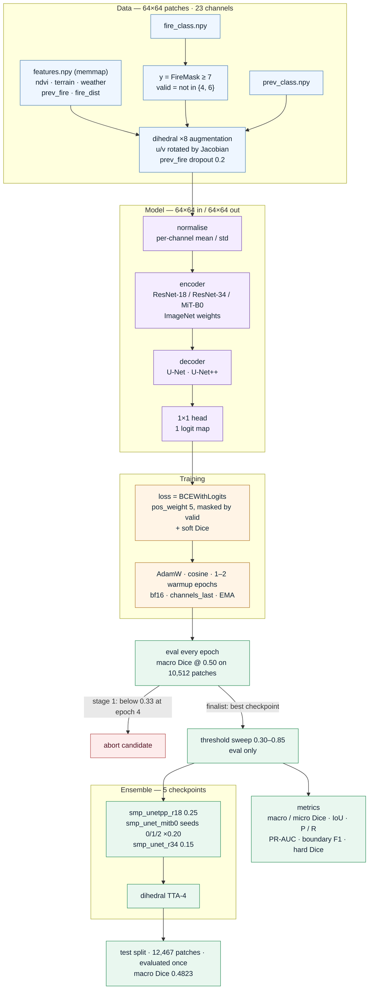

# Architecture

One run, start to finish. Mermaid source: [`architecture.mmd`](architecture.mmd) ·
renders: [`architecture.svg`](architecture.svg) · [`architecture.png`](architecture.png)

## Shape flow

`(B, 23, 64, 64)` → encoder ×32 down → `(B, 512, 2, 2)` → decoder + skip connections →
`(B, 1, 64, 64)` logits → sigmoid at the tuned threshold. Predictions are made on the
64×64 patch grid, i.e. the native label resolution; upsampling at inference was
measured and gave nothing (`docs/RESULTS.md`).

## Why these pieces

| Piece | Reason it survived |
|---|---|
| U-Net++ / U-Net decoder on ImageNet trunk | Best of six screened families (0.4686 eval) |
| `pos_weight 5` BCE + soft Dice | Dice controls the empty-ish patches, BCE keeps gradients sane |
| EMA + bf16 + channels_last | Free accuracy and ~1.6× throughput on L4 |
| Dihedral ×8, u/v Jacobian-rotated | Only augmentation that is physically consistent |
| 5-model blend, weights on eval | +0.002–0.003 over best single; the gap is inside the CI, so it is insurance, not a claim |

## Rejected after measurement

| Idea | Why it lost |
|---|---|
| DeepLabV3+ (stride-4 output) | −0.10 macro Dice, too coarse for 7-px fires |
| 2× input upsampling | 4× compute, no gain |
| Dual-branch fuel/weather + CAFIM | Too slow to converge inside the budget |
| Shift TTA, 8-way TTA, centre-radius mask, extra seeds | Neutral or negative; see `docs/RESULTS.md` |
