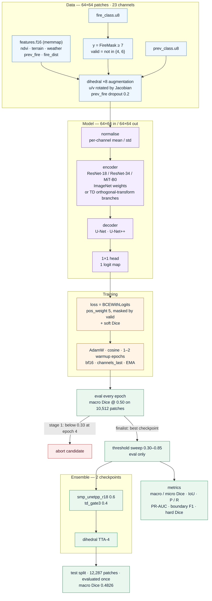
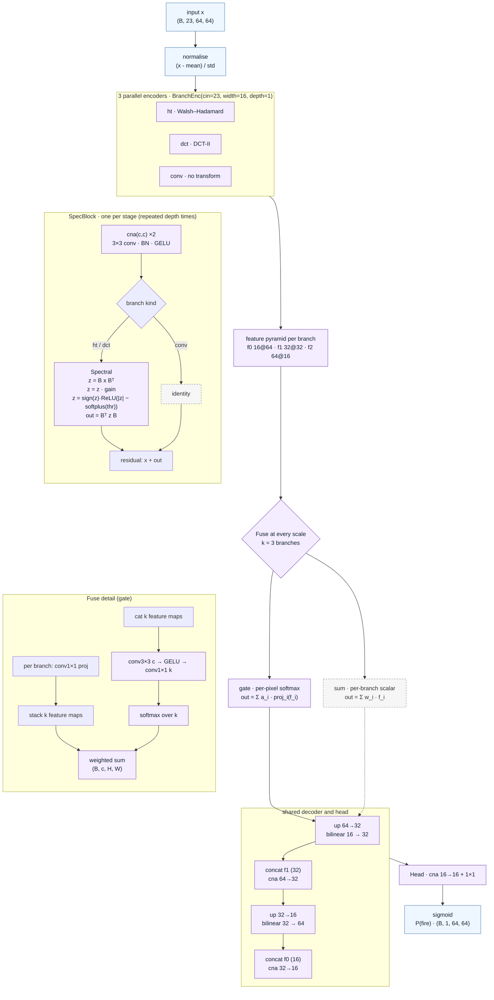

# Architecture

One run, start to finish. Mermaid source: [`architecture.mmd`](architecture.mmd) ·
renders: [`architecture.svg`](architecture.svg) · [`architecture.png`](architecture.png)

Custom trunk in detail: [`td_architecture.mmd`](td_architecture.mmd) — renders
[`.svg`](td_architecture.svg) · [`.png`](td_architecture.png) (also embedded below).

## Shape flow

`(B, 23, 64, 64)` → encoder ×32 down → `(B, 512, 2, 2)` → decoder + skip connections →
`(B, 1, 64, 64)` logits → sigmoid at the tuned threshold. Predictions are made on the
64×64 patch grid, i.e. the native label resolution; upsampling at inference was
measured and gave nothing (`docs/RESULTS.md`).

## TD trunk — the custom architecture

`trunk: "td"` (candidate `td_gate3`). Same input/output contract as the U-Net line —
23×64×64 in, 1×64×64 logits out — but the encoder runs one orthogonal-transform
branch per basis and fuses them at every scale, so no single branch commits alone.

`cna` = Conv3×3 (no bias) → BatchNorm → GELU. `B` is a fixed orthonormal matrix
(Walsh–Hadamard, or DCT-II) baked in as a buffer; `gain` and `thr` are learned
per coefficient, so the transform itself never has to be learned.

### Shape and parameter budget (`td_gate3`)

| stage | tensor | parameters |
|---|---|---|
| branch `ht` (stem + 3 stages) | 23 → 16@64 → 32@32 → 64@16 | 353k |
| branch `dct` (stem + 3 stages) | 23 → 16@64 → 32@32 → 64@16 | 353k |
| branch `conv` (control, same stem/stages) | 23 → 16@64 → 32@32 → 64@16 | 124k |
| fuse ×3 scales (gate) | 16/32/64 channels | 162k |
| decoder + head | 64→32→16 → 1 logit | 49k |
| **total** | | **1.04M** |

### Why this shape

| Choice | Reason |
|---|---|
| Deepest feature is 16×16, not 2×2 | A 32× downsampled trunk decides "is this 500-px region burning" on a 2×2 grid; the TD trunk keeps the coarse decision at 16×16 and the skip path at the native 64×64. |
| Two spectral bases + one plain conv | `ht` gives axis-aligned cheap sparsity, `dct` gives smooth energy compaction, `conv` keeps a path for features neither basis represents. With one branch the model is just a small U-Net. |
| Gate fusion, not sum | Ties sum on score (0.4580 vs 0.4578 screen) but lets each scale pick a branch; sum stays available as `fusion: "sum"`. |
| Width 16, depth 1 | Widening (24) or deepening (2) bought nothing at 6× the training time. |
| 1M params | Ties the 16M ResNet-18 U-Net++ (0.4662 vs 0.4681 eval), which is the parameter-efficiency claim of the TD-FusionUNet line that actually reproduced. |
| No pretrained weights | Forces the transform branches to carry the representation; also makes the whole run 1M params on disk. |

Known failure mode, measured on test: the trunk predicts shape at roughly 1-km
resolution, so large fires come out as a crescent on the burn-scar rim rather than a
filled area. Parameter count and transform choice do not move that
(`docs/RESULTS.md`, *What did not work*).

## Why these pieces

| Piece | Reason it survived |
|---|---|
| U-Net++ / U-Net decoder on ImageNet trunk | Best of six screened families (0.4681 eval, rebuilt cache) |
| `pos_weight 5` BCE + soft Dice | Dice controls the empty-ish patches, BCE keeps gradients sane |
| EMA + bf16 + channels_last | Free accuracy and ~1.6× throughput on L4 |
| Dihedral ×8, u/v Jacobian-rotated | Only augmentation that is physically consistent |
| 2-model blend, weights on eval | +0.002 over the best single; the gap is inside the CI, so it is insurance, not a claim |
| TD orthogonal-transform trunk (1M params) | Ties the 16M U-Net++ at 6% of the parameters; kept in the blend for diversity |

## Rejected after measurement

| Idea | Why it lost |
|---|---|
| DeepLabV3+ (stride-4 output) | −0.10 macro Dice, too coarse for 7-px fires |
| 2× input upsampling | 4× compute, no gain |
| Dual-branch fuel/weather + CAFIM | Too slow to converge inside the budget |
| Learned pixel-gate fusion in the TD trunk | No better than a scalar branch sum |
| Multi-head (boundary + growth) TD variant | 30% slower, no gain |
| Per-sample thresholds, prediction dilation | No honest gain on eval; see `docs/RESULTS.md` |
| Shift TTA, 8-way TTA, centre-radius mask, extra seeds | Neutral or negative; see `docs/RESULTS.md` |
