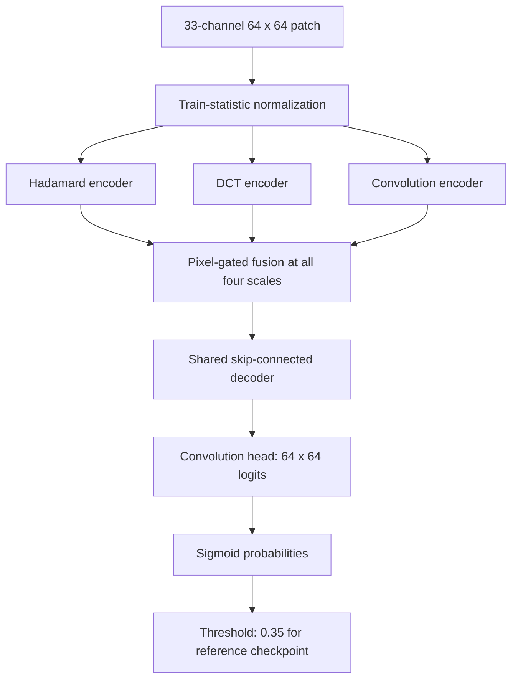

# WildfireTD4

This named model fixes the architecture of the selected completed Kaggle run,
`final_td4_w24_tversky_recall_seed0`. It does not introduce unmeasured changes
to that architecture. Source: `wf/primary.py`; reusable layers and historical
architectures remain in `wf/models.py`.

Encoder widths are 24/48/96/192 at 64/32/16/8 pixels. Each branch has one
spectral/convolution block per scale. The decoder width multiplier is one;
there is one main head, no area head, deep supervision, upsample branch, SE
attention or external-weather stream. Parameter count is 5,973,133.

Inputs follow `wf.data.CHANNELS` in exact order. Mean/std are buffers stored
inside the checkpoint. Supply unnormalized features; do not normalize twice.
The output dictionary contains `main` with shape `N x 1 x 64 x 64` logits.
Input dimensions/channels are checked explicitly.

Training uses focal Tversky with alpha=0.4 (FP), beta=0.6 (FN), gamma=1.33,
AdamW, EMA, FP16, cosine learning rate, two warmup epochs, batch size 32,
learning rate 0.002, and previous-fire dropout 0.2. Budget: up to 60 epochs,
patience 12, max 2400 seconds, seed 0 by default. Threshold/checkpoint selection
uses tuning only. This matches the recorded finalist recipe.

The reference trained on 21,719 patches and tuned on 1,248. Best checkpoint was
epoch index 20, with tuning macro Dice 0.4496570, micro Dice 0.4577008 and IoU
0.2967652. Confirmation and test scores have not been supplied. The checkpoint
is referenced on Kaggle; its binary has not been copied into this repository.

The dedicated class preserves parameter names and shapes, allowing strict
loading of the legacy finalist checkpoint. It is not a weather-fusion model:
the best available completed run selected here uses image/cache inputs alone.

The positive-crop dataset construction and cumulative progression targets are
unchanged. This is not a reproduction of the official full-frame temporal
TS-SatFire benchmark. Older NDWS results have a separate evaluation protocol.

## Refactor validation

Kaggle notebook: https://www.kaggle.com/code/anekazek/wildfire-td4-contract-check

Six focused tests passed on Kaggle, including the parameter count and exact
prediction equality after loading a synthetic legacy-format EMA checkpoint.
The actual reference checkpoint binary has not been retrieved or tested by
this refactor. CLI help, Python compilation and project TOML parsing also
passed. No model retraining or local experiment computation was performed.
