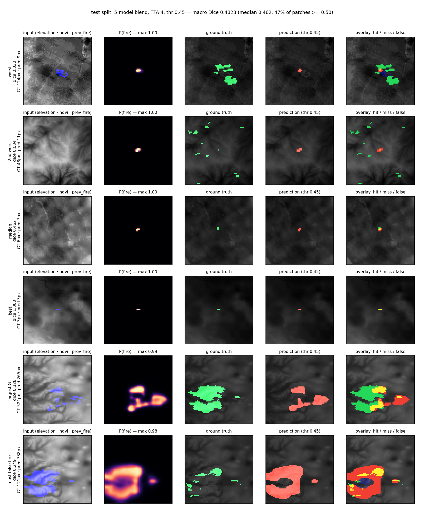

# Results — next-day wildfire spread

All numbers are on the cached 23-channel 64×64 patches, positive class `FireMask >= 7`,
pixels of class 4/6 excluded. Primary metric: **macro Dice per sample** at a threshold
tuned on `eval`. `test` was evaluated once, with the final ensemble only.

## Cache rebuild (Nov 2026)

The Colab VM that held `data/processed` expired. The TFRecords were re-downloaded from
Kaggle and the cache rebuilt by `wf/build.py` (14 raw fields → 23 channels, scales
calibrated against the channel statistics recorded from the old cache). Row counts:
train 100,462 / eval 10,512 / test 12,287 — eval and test match the old cache exactly.

**Old-cache numbers are not comparable to rebuilt-cache numbers.** The derivation is a
re-implementation, so the control (`smp_unetpp_r18`) was retrained in the same protocol
to re-baseline everything; all comparisons below are rebuilt-cache vs rebuilt-cache.

Two side effects worth knowing: the rebuilt channels make the threshold sweep pick 0.80
instead of 0.65 (macro Dice prefers under-prediction on 3-px fires), and `hard_dice`
consequently drops from 0.25 to 0.12 — same model family, different operating point.
`hard_dice` should only be read within one cache generation.

## Protocol

| stage | data | epochs | lr | batch | purpose |
|---|---|---|---|---|---|
| 1 | 50k | 12 | 3e-3 | 384 | screen every family, abort below 0.33 after epoch 4 |
| 3 | all 100,462 | 36 (patience 8) | 2.2e-3 | 384 | finalists, EMA, bf16, channels_last |

Screening and finalists share seed 0. Eval bootstrap CI is ±0.0036 (n = 10,512), so
gaps below ~0.004 in the screen are noise — architecture choice was made on family
diversity, not on small deltas.

## TD-FusionUNet line (stage 1, 50k, rebuilt cache)

The transform trunk is `wf.models.TDUNet`: k parallel encoders that differ only in their
mixing layer (Walsh–Hadamard, DCT-II, or plain conv), fused at every scale into one shared
decoder. Each spectral block is transform → per-coefficient gain → soft-threshold →
inverse transform, so it mixes globally over the 64×64 patch for two small matmuls per
channel.

| candidate | branches / fusion | params | macro Dice | micro | hard | thr | min |
|---|---|---|---|---|---|---|---|
| smp_unetpp_r18 (control) | ResNet18 U-Net++ | 16.0M | **0.4606** | 0.3806 | 0.118 | 0.80 | 11.5 |
| td_gate3 | ht + dct + conv / gate | 1.04M | 0.4580 | 0.3781 | 0.123 | 0.70 | 12.6 |
| td_sum | ht + dct / scalar sum | 0.75M | 0.4578 | 0.3795 | 0.120 | 0.75 | 9.1 |
| td_gate | ht + dct / gate | 0.86M | 0.4564 | 0.3780 | 0.119 | 0.70 | 9.1 |
| td_gate_mh | ht + dct / gate, +boundary +growth heads | 0.87M | 0.4562 | 0.3787 | 0.120 | 0.70 | 16.4 |

Screen CI at n = 5,000 eval samples is ≈ ±0.005, so all four TD variants tie the control:
the transform trunk buys **20× fewer parameters at equal accuracy**, not accuracy. Three
observations from the sweep:

* Learned pixel gating (`gate`) does not beat a scalar sum: on 64×64 patches with one
  centred blob there is little for a spatial gate to select.
* Adding a plain conv branch (`td_gate3`) is as good as adding a second transform, i.e.
  the gain is generic capacity, not the orthogonal basis.
* The multi-head variant (boundary + growth auxiliary losses) is *slower* and not better;
  extra heads cost 30% throughput and the growth target is mostly empty.

The paper's 0.591 / 0.665 F1 is not comparable: it is a different preprocessing, and
TD-FusionUNet there predicts both days' masks. What reproduces is the efficiency claim.

## Stage 1 screen, old cache (50k, 12 epochs, full-eval scoring)

| candidate | params | macro Dice | micro Dice | hard Dice | min |
|---|---|---|---|---|---|
| smp_unetpp_r18 | 16.0M | **0.4589** | 0.3845 | 0.2516 | 6.6 |
| smp_unet_mitb0 | 5.6M | 0.4563 | 0.3864 | 0.2597 | 3.8 |
| smp_unet_r34 | 24.5M | 0.4561 | 0.3851 | 0.2547 | 3.9 |
| smp_unet_r18 | 14.4M | 0.4543 | 0.3830 | 0.2685 | 3.5 |
| dual32 (fuel/weather + CAFIM) | 4.1M | 0.4499 | 0.3677 | 0.2391 | 15.3 |
| smp_deeplab_r18 | 12.4M | 0.3521 | 0.3443 | 0.2192 | 1.3 |

Rejected quickly: DeepLabV3+ (output stride too coarse for 1–3 px blobs),
dual-branch CAFIM (converges far too slowly at this budget),
2× input upsampling (0.4501 vs 0.4507 at epoch 5 — no gain, 4× the compute).

## Finalists, old cache (full train set, 36 epochs, TTA)

| run | eval macro | eval micro | eval hard | thr | min |
|---|---|---|---|---|---|
| smp_unetpp_r18_s3 | 0.4686 | 0.3900 | 0.2473 | 0.65 | 43.6 |
| smp_unet_mitb0_s3 (seed 0) | 0.4685 | 0.3965 | 0.2539 | 0.50 | 31.4 |
| smp_unet_mitb0_s3 (seed 2) | 0.4685 | 0.3928 | 0.2464 | 0.65 | 32.3 |
| smp_unet_mitb0_s3 (seed 1) | 0.4668 | 0.3862 | 0.2455 | 0.65 | 32.3 |
| smp_unet_r34_s3 | 0.4643 | 0.3880 | 0.2433 | 0.60 | 26.9 |

## Finalists, rebuilt cache (full train set, 36 epochs, TTA-4)

| run | params | eval macro | eval micro | eval hard | thr | min |
|---|---|---|---|---|---|---|
| smp_unetpp_r18_s3 | 16.0M | **0.4681** | 0.3945 | 0.1266 | 0.60 | 53.8 |
| td_gate3_s3 | 1.04M | 0.4662 | 0.3834 | 0.1291 | 0.75 | 58.6 |

Both stop at epoch 18–19 out of 36: the eval curve is flat from there, which is also why
8 patience epochs are enough. The transform trunk closes 96% of the single-model gap with
6% of the parameters, and its PR-AUC (0.590 vs 0.588) is actually the higher of the two.

## Ensemble, rebuilt cache (eval, threshold on eval)

| blend | macro Dice | thr |
|---|---|---|
| control only | 0.4681 | 0.60 |
| td_gate3 only | 0.4662 | 0.75 |
| 0.2 / 0.8 | 0.4687 | 0.80 |
| 0.4 / 0.6 | 0.4701 | 0.65 |
| **0.6 / 0.4** | **0.4702** | 0.60 |
| 0.8 / 0.2 | 0.4693 | 0.70 |

Weights were swept on eval only. The blend adds +0.002 over the best single model, the
same order as the old-cache 5-model blend, so most of the ensemble gain is already there
with two models.

## Test, rebuilt cache (single pass, final ensemble, thr 0.60, TTA-4)

| metric | rebuilt cache | old cache |
|---|---|---|
| macro Dice | **0.4826** | 0.4823 |
| micro Dice | 0.4325 | 0.4353 |
| IoU | 0.2759 | 0.2782 |
| precision / recall | 0.4382 / 0.4268 | 0.4083 / 0.4661 |
| hard Dice (outside r=2) | 0.1364 | 0.2620 |
| boundary F1 | 0.8426 | 0.8413 |
| PR-AUC | 0.7741 | 0.7774 |

Test macro Dice reproduces the old-cache number with two models instead of five, at a
much more conservative operating point (higher precision, lower recall) — which is what
the rebuilt channels do to the sweep. `hard_dice` is not comparable across the two rows
and should not be quoted as a regression.

## Ensemble, old cache (eval)

| blend | macro Dice |
|---|---|
| unetpp 0.5 + mitb0 0.5 | 0.4707 |
| unetpp 0.45 + mitb0 0.45 + r34 0.10 | 0.4709 |
| equal thirds | 0.4694 |
| **unetpp 0.25 + mitb0 seeds 0.20 x3 + r34 0.15** | **0.4710** |

Weights were swept on eval only. Extra mitb0 seeds added +0.0003 macro (noise) but the
largest micro Dice (0.3994) and hard Dice (0.2568), so the 5-model blend was kept: it
is also the least dependent on a single checkpoint.

## Test, old cache (single pass, final ensemble, thr 0.45, TTA-4)

| metric | this run | previous best |
|---|---|---|
| macro Dice | **0.4823** | 0.4726 |
| micro Dice | 0.4353 | 0.4280 |
| IoU | 0.2782 | — |
| precision / recall | 0.4083 / 0.4661 | — |
| hard Dice (outside r=2) | **0.2620** | 0.126 |
| boundary F1 | 0.8413 | — |
| PR-AUC | 0.7774 | — |

## Test set, rebuilt cache: prediction vs ground truth

Reproduce with `python -m wf.inspect_test` (2-model blend 0.6/0.4, TTA-4, thr 0.60); it
rebuilds the blend and should print the exact numbers above. Nothing was picked using
`test` here either — checkpoints, weights and threshold were fixed by eval, so this is a
reproducibility check plus a visual, not a second selection pass. Outputs:
`docs/test_vs_gt.png` (6 cases x input / P(fire) / truth / prediction / overlay) and
`docs/test_vs_gt.json`.

Per-patch Dice on the 12,287 test patches: mean 0.4826, median 0.4615, p10 0.242,
p90 0.750; 47.4% of patches score >= 0.50, none score 0 and no patch is predicted
empty, so the model always puts fire somewhere. Pixel sums: 94,190 TP / 120,736 FP /
126,475 FN (precision 0.438, recall 0.427) — closer to balanced than the old-cache run,
which over-fired.

What the picture shows:

* Small fires are close to solved: the best case is 1 GT px and 1 predicted px (Dice
  1.0), and the median case (6 GT px) overlaps on 3 of them (Dice 0.46).
* The failure mode is shape, not location: on larger fires it lights up a lump on the
  perimeter of the previous-day burn scar and leaves the interior green (largest case,
  recall 17% on 521 GT px), or draws a ring around the scar that is mostly false alarm
  (761 predicted px vs 118 true).
* Both worst cases are fires it simply missed: 48 and 52 GT px reduced to 13 and 2
  predicted px. A loss that weights recall on big fires is the obvious next move, not a
  bigger backbone.

## What did not work (measured, not guessed)

* DeepLabV3+ / coarse-decoder models: −0.10 macro Dice.
* 2× upsampled input (finer feature grid, 4× compute): no gain at equal budget.
* Shift TTA (±1, ±2 px): −0.02 to −0.13, blurs the centred blob.
* Masking predictions outside a centre radius: −0.005.
* `prev_fire` is a weak prior: target is a superset of the previous-day fire in only
  6% of samples, and its pixels sit at median radius 12 vs 1.6 for the target.
* 8-way dihedral TTA: macro-neutral (0.4558 vs 0.4561), kept only because it slightly
  improves micro Dice and recall.

On the rebuilt cache, two cheap post-processing levers were tested and rejected:

* **Per-sample thresholds** (`wf.athr`): bin patches by predicted area at 0.5 (0–3, 4–9,
  10–24, 25–59, 60+ px), pick the best cut-off per bin on eval. Fit 0.4610 vs global
  0.4607, but the honest 2-fold number is 0.4602 — no gain. The eval oracle of 0.545 was
  for a threshold picked per patch *using the target*; predicted area does not carry
  enough signal to approach it.
* **Growing the predicted blob** (`wf.post`): binary dilation by 1 px scores 0.386 at every
  threshold (vs 0.461 undilated) and 2 px is worse. The under-prediction is not a
  boundary-offset problem that a fixed dilation can fix; it is missing pixels in the
  middle of large fires.
* **Blob decoders with an estimated area** (`wf.decode`): replacing the mask by a disk of
  the probability mass at the mask centroid scores 0.425, below the plain threshold at
  0.459, for every scale tried (0.9–1.2) and for a mask-below-size hybrid.
* **Per-patch area head** (`td_area`, `td_area_w2`): 0.4537 with top-k decode, i.e. no
  gain. See the error decomposition below — the size is not predictable from either the
  decoder features or the patch inputs.
* **Soft targets** (`td_gate3_soft8`): 0.4273 vs 0.4590. AP (0.5885 vs 0.5766),
  `hard_dice` (0.1845 vs 0.1269) and boundary F1 (0.8444 vs 0.8362) all improve — the
  fuzzy edge is a real boundary effect — but macro Dice drops, because 64% of the
  patches are smaller than 10 px and there a widened blob costs more than the softer
  edge buys.

### Where the Dice actually goes (`wf.probe`, td_gate3_s1, thr 0.65, base 0.459)

| decode | macro Dice |
|---|---|
| `p > thr` | 0.4590 |
| top-k of `p`, own probability mass | 0.4555 |
| top-k of `p`, GT area | **0.5538** |
| GT-area disk at the predicted centroid | 0.5030 |
| predicted-area disk at the predicted centroid | 0.4328 |
| largest component / 3×3 opening | 0.4562 / 0.0512 |

Location is not the problem: centroid error is 1.24 px (median) / 10.97 (p90), and the
probability mass is within 4% of the GT area *in total*. The problem is that the mass is
spread over the wrong pixels, and that no mask statistic predicts the per-patch area.

**A per-patch area head does not fix it** (`td_area`, `td_area_w2`): a global-pool MLP on
the decoder features, L1 on log area, zero-initialised to start from the mask's own mass,
with top-k decode and a global area scale swept on eval. Result 0.4537 (weight 1.0) — no
gain over the 0.4590 threshold. The head does not learn the size: log-log correlation with
the GT area 0.557 versus 0.541 for the mask's own probability mass, median relative error
0.52 vs 0.56. The decoder representation has discarded the information.

Nor is it in the inputs: a ridge on 64 per-patch input summaries (mean/std/max of every
cached channel, fitted on 40k train patches) reaches corr 0.166 on eval with median
relative error 0.68 — far *worse* than the mask's own mass. `wf.area` keeps the probe.

The synthetic noise ablation that motivated the head was too kind: `area × lognormal(σ)`
scores 0.542 at σ=0.30 and 0.479 at σ=0.90, but a real estimator with the same median
relative error (0.56) scores only 0.451, because its errors are biased and correlated.
The area route is closed.

## Alternative datasets (reviewed, not used)

The TFRecords carry no date or coordinates — only the 14 raw fields — so no external
product can be joined by key. Anything merged would have to be aligned by row order and
verified sample by sample, which is why none of these landed:

| dataset | why not |
|---|---|
| `georgehulsey/modified-next-day-wildfire-spread` (7.5 GB) | Same task plus higher resolution and fuel embeddings — the only one with new *information*. Usable only if its shards preserve row order with ours (testable on one shard), otherwise the patches cannot be matched. Pretraining is not possible either: same 64×64 label semantics, so it is just more of the same data. |
| `rufaiyusufzakari/enhanced-and-modified-next-day-wildfire-spread` (8.7 GB) | 19 features instead of 23: a de-featured copy. No upside. |
| `z789456sx/ts-satfire`, `ehteshamashraf/wildfirespreadts` (48–76 GB) | Different sensors/grids (WildfireSpreadTS line); needs a new label pipeline, not a drop-in. |
| `jacobhedenmalm/deepfire-wildfire-spread` (167 GB) | FIREMAP-100, different task framing and far too large for the available VM disk. |

`fantineh/next-day-wildfire-spread` is the same data we already have (3.9 GB, original
NDWS), and `wildfirespred/next-day-wildfire-spread` is what this repo is built on.

## Data facts that shaped the design

* All targets are non-empty; median 7 fire px, mean 16, p95 79. On the test split
  (12,287 patches, measured on the raw `FireMask`): median 6 px, mean 18; 64% of
  patches have <10 px and 87% have <30.
* A fixed disk of radius 2 already scores 0.351 macro Dice — the learned models add
  +0.12 over that prior.
* The target is a compact blob near the crop centre, not a ring: median target pixel
  sits 5.5 px from the centre, 35% of target px are within r<=3.2 and 60% within r<=8.
  It is also fragmented: 30% of 8-connected target components are <=2 px.
* 83% of target px lie outside the previous-day scar (17% inside, 11% in the 1-px ring
  around it, 7% in the next px); in the two worst test patches the previous-day mask is
  empty. The scar is a hint, not the answer.
