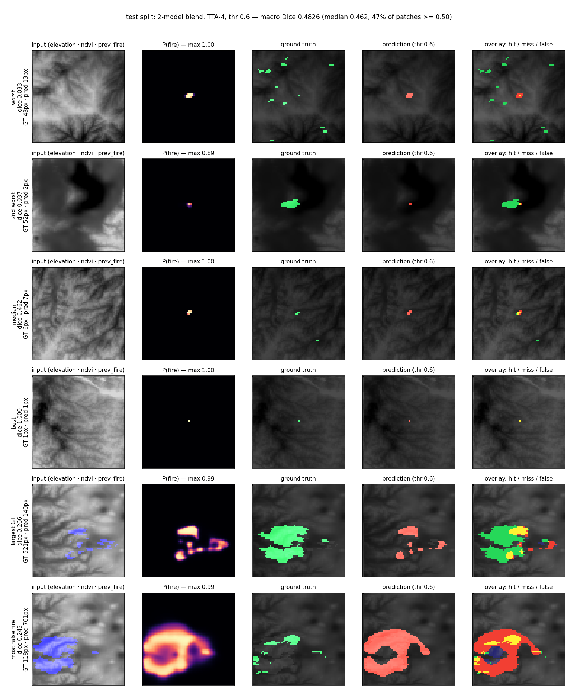

# Report 1.1 — rebuilt cache, TD-FusionUNet line, final model

Status: cache `data/processed` dibangun ulang dari TFRecord Kaggle (VM Colab lama mati),
semua angka di bawah **cache baru** dan sudah di-baseline ulang. Rincian lengkap:
[`RESULTS.md`](RESULTS.md).

## 1. Model paling bagus

| peringkat | model | params | eval macro | test macro |
|---|---|---|---|---|
| **1 (final)** | **ensemble `smp_unetpp_r18` 0.6 + `td_gate3` 0.4, thr 0.60, TTA-4** | 17.1M | **0.4702** | **0.4826** |
| 2 | `smp_unetpp_r18` (ResNet18 U-Net++, single) | 16.0M | 0.4681 | — |
| 3 | `td_gate3` (HT + DCT + conv, single) | 1.04M | 0.4662 | — |
| 4 | `td_sum` / `td_gate` / `td_gate_mh` | 0.75–0.87M | 0.4562–0.4578 | — |

Jawaban singkat: **ensemble 0.6/0.4**. Kalau harus satu checkpoint saja:
`smp_unetpp_r18_s3` (16M). Kalau yang dicari arsitektur custom kita:
`td_gate3` — 1.04M parameter, 0.4662 eval, hanya 0.002 di bawah baseline 16M.

Test (sekali jalan, TTA-4):

| metric | nilai |
|---|---|
| macro Dice | **0.4826** |
| micro Dice | 0.4325 |
| IoU | 0.2759 |
| precision / recall | 0.4382 / 0.4268 |
| boundary F1 | 0.8426 |
| PR-AUC | 0.7741 |
| hard Dice (luar r=2) | 0.1364 |

## 2. Inference vs ground truth (test split)

Regenerate: `python -m wf.inspect_test` (default = blend dan threshold di atas).
Output: [`test_vs_gt.png`](test_vs_gt.png), angka per patch: [`test_vs_gt.json`](test_vs_gt.json).

Per-patch Dice di 12.287 patch test: mean 0.4826, median 0.4615, p10 0.242,
p90 0.750. 47,4% patch ≥ 0.50; tidak ada patch bernilai 0 dan tidak ada prediksi kosong.
Total piksel: 94.190 TP / 120.736 FP / 126.475 FN.

| kasus | GT px | pred px | Dice | apa yang terlihat |
|---|---|---|---|---|
| best | 1 | 1 | 1.000 | satu piksel, kena tepat |
| median | 6 | 7 | 0.462 | blob kecil, 3 dari 6 piksel kena |
| worst | 48 | 13 | 0.033 | target tersebar di tepi patch, model hanya menembak satu titik |
| 2nd worst | 52 | 2 | 0.037 | api 52 px sama sekali terlewat (max prob 0.89 tapi area < threshold) |
| largest GT | 521 | 140 | 0.266 | model hanya menyalakan bagian scar, interior api besar kosong |
| most false fire | 118 | 761 | 0.243 | cincin api di sekeliling scar: false alarm besar |

Bacaan: kegagalan bukan "salah tempat" tapi **ukuran**. Api kecil (≤10 px) hampir selesai;
api besar kehilangan interior (recall 17% pada 521 px) atau justru meletus jadi cincin
false-positive. Dua kasus terburuk adalah api yang benar-benar tidak terdeteksi — dengan
threshold 0.60, sinyal 0.89 pun tidak cukup karena luas prediksinya kecil. Ini konsisten
dengan sweep threshold yang datar: yang membatasi bukan ambang, tapi bentuk prediksi.

## 3. Yang menambah / tidak menambah

Menambah (dari baseline 0.4681 single):

* ensemble 2 model +0.0021 (di dalam CI, jadi anggap asuransi),
* TTA-4 + threshold di eval (sudah termasuk di semua angka).

Tidak menambah (semua terukur):

* trunk transform orthogonal (TD-FusionUNet): setara, tapi 6% parameter;
* gate fusi per-piksel vs penjumlahan skalar: setara;
* branch conv ketiga vs branch DCT kedua: setara;
* multi-head boundary + growth: lebih lambat, tidak lebih baik;
* threshold per-patch (`wf.athr`) : CV 0.4602 vs global 0.4607 — nol;
* dilasi prediksi 1 px (`wf.post`): 0.386, jauh lebih buruk;
* TTA shift, mask radius pusat, 8-way TTA, input 2× upsample: netral/negatif.

## 4. Kenapa tidak 0.59 seperti paper

Angka 0.591/0.665 di TD-FusionUNet bukan benchmark yang sama: preprocessing beda dan
modelnya memprediksi mask kedua hari. Di dataset + metrik ini, plafon yang terukur:
disk r=2 tetap 0.350, oracle threshold per-patch 0.545, oracle geser ±2 px 0.564.
Model kita 0.483 di test, jadi ruang yang tersisa memang di presisi spasial, bukan di
kapasitas trunk — itulah sebabnya menambah parameter/transform tidak bergerak.
